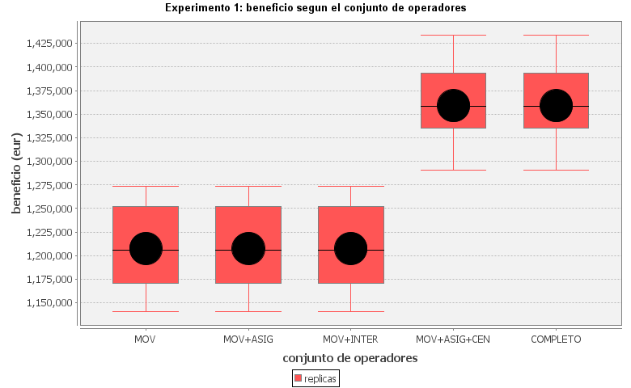
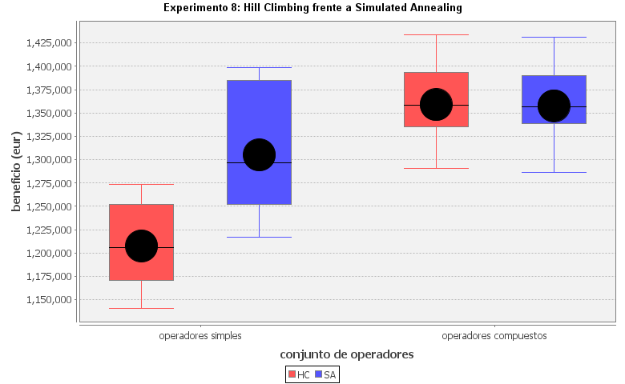

::: {.callout-note}
## Resum

Estudiem com assignar 1.000 clients a 40 centrals elèctriques maximitzant el
benefici i respectant les capacitats, les pèrdues de transport i el servei dels
clients garantits. Comparem Hill Climbing i Simulated Annealing i mesurem
l'efecte dels operadors, de la solució inicial, de les heurístiques i dels
paràmetres del recuit simulat.
:::

## 1. Context i materials

El projecte és una implementació pròpia en Java de la pràctica de cerca local.
El codi desenvolupat pel grup és a `../src/IA/PracticaEnergia/`. Les llibreries
externes i el material de suport es mantenen separats:

- `lib/CentralEnergia.jar` i `lib/AIMA.jar` són dependències proporcionades per
  l'assignatura.
- `../docs/aima-src/` és el codi font d'AIMA inclòs en `AIMA.src.zip`, lliurat
  com a material docent i consultat per entendre el comportament dels
  algorismes.
- `../docs/javadoc/` és el Javadoc de `CentralEnergia.jar`, inclòs amb el
  material de la pràctica. No és codi desenvolupat pel grup.

Aquesta distinció és important: les carpetes anteriors serveixen per consultar
les interfícies i les implementacions de suport, però no formen part de la
solució pròpia.

## 2. Model del problema

Cada estat representa l'assignació de cada client a una central o a
`-1` (client no servit). Una assignació és vàlida si cap central supera la
seva producció i tots els clients garantits reben servei. El benefici és:

$$
\text{ingressos dels clients servits}
- \text{cost de les centrals}
- \text{indemnitzacions dels clients no garantits no servits}.
$$

En l'escenari base hi ha 5 centrals de tipus A, 10 de tipus B i 25 de tipus C,
i 1.000 clients amb proporcions 25 % XG, 30 % MG i 45 % G. L'espai de
solucions és de l'ordre de $41^{1000}$ assignacions. Tanmateix, el benefici
depèn sobretot de quines centrals estan enceses i no de la distribució exacta
dels clients. Això crea moltes mesetes i explica la importància dels operadors
compostos.

La representació manté les dades estàtiques compartides i copia només els
arrays que canvien. A més, actualitza incrementalment el benefici i les
ocupacions. Les proves de `PruebaEstado` verifiquen còpies, operacions,
capacitats, clients garantits, reproducibilitat i coherència del benefici.

## 3. Disseny de la cerca

S'han implementat tres famílies d'operadors: moviment d'un client, assignació
amb canvi de central i obertura/tancament de centrals. El conjunt que funciona
millor és `MOVER_ASIGNAR_CENTRALES`, perquè pot canviar directament el conjunt
de centrals enceses. Afegir l'intercanvi de clients no millora les solucions i
augmenta el cost de cada pas.

La solució inicial **VORAZ** assigna primer els clients més exigents de forma
localment convenient. És millor que la inicial aleatòria: acaba amb un benefici
mitjà de 1.358.883 € davant d'1.282.558 €, i guanya en les 10 rèpliques.

Les tres heurístiques implementades són benefici pur, penalització de pèrdues i
penalització de capacitat ociosa. Amb operadors compostos, el benefici pur és
prou informatiu i les altres heurístiques només afegeixen passos. Amb operadors
simples, en canvi, la capacitat ociosa ajuda a trencar la meseta: millora el
benefici un 5,9 % i guanya en les 10 rèpliques.

## 4. Experiments i resultats

Cada configuració es prova amb 10 rèpliques i les mateixes llavors. Per això
les comparacions són emparellades i es pot aplicar el contrast binomial
$B(10, 0,5)$. El detall complet, incloses totes les taules, es conserva a
[`../INFORME.md`](../INFORME.md) i les dades originals a `../resultados/`.

### 4.1. Operadors i veïnatge

Amb només operadors de moviment, Hill Climbing es queda en un sol pas i un
benefici mitjà de 1.207.656 €. En afegir obertura i tancament de centrals,
arriba a 1.358.883 € de mitjana, una millora del 12,5 % i significativa en les
10 rèpliques ($p = 0,002$). El conjunt complet dona la mateixa qualitat però
triga aproximadament un 44 % més.

El veïnatge `k = 8` és un compromís adequat: ampliar-lo multiplica el temps
però gairebé no canvia el benefici. La majoria de centrals llunyanes no
apareixen en solucions bones.

{width=88%}

### 4.2. Simulated Annealing

El benefici del recuit simulat és poc sensible a `k` i a la temperatura dins
del rang provat. El temps sí que canvia molt: amb `lambda = 1` la temperatura
arriba a zero massa aviat, mentre que `lambda = 0,01` dona una qualitat
semblant a `0,0001` amb menys temps. Es fixa la configuració de 100.000
iteracions, 1.000 iteracions per temperatura i `lambda = 0,01`.

Amb operadors simples, Simulated Annealing supera Hill Climbing (1.305.068 €
contra 1.207.656 €) perquè pot recórrer moviments laterals de la meseta.
Amb els operadors compostos, els dos algorismes donen pràcticament el mateix
benefici, però Hill Climbing és unes 27 vegades més ràpid.

{width=88%}

### 4.3. Escalat i factibilitat

El temps creix aproximadament de forma lineal amb el nombre de clients quan el
nombre de centrals és fix. Amb 1.250 clients l'escenari és infactible: la
demanda mínima, tenint en compte les pèrdues, ja s'apropa al 93 % de la
capacitat instal·lada i no es pot trobar cap repartiment vàlid.

Augmentar el nombre de centrals no sempre millora el resultat. Les centrals
parades tenen un cost i, amb la demanda fixa, passar de 40 a 160 centrals
redueix el benefici mitjà de 1.358.883 € a 714.225 €.

## 5. Conclusions

1. El disseny dels operadors és més determinant que escollir entre Hill
   Climbing i Simulated Annealing.
2. `MOVER_ASIGNAR_CENTRALES`, la inicial voraz i `k = 8` ofereixen una bona
   combinació de qualitat i temps.
3. Les heurístiques secundàries són útils per diagnosticar les mesetes, però no
   calen quan els operadors compostos ja mostren el canvi de qualitat complet.
4. Simulated Annealing és útil amb operadors simples, però el seu cost no es
   justifica quan Hill Climbing disposa d'operadors adequats.
5. La factibilitat depèn tant de la capacitat com de les pèrdues i de la
   distribució geogràfica dels clients.

## 6. Reproducció

Amb JDK 26 o superior, des de l'arrel del repositori:

```powershell
javac -cp "lib\CentralEnergia.jar;lib\AIMA.jar" `
  -d out (Get-ChildItem -Recurse src -Filter *.java | % FullName)
java -cp "out;lib\CentralEnergia.jar;lib\AIMA.jar" `
  IA.PracticaEnergia.PruebaEstado
java -Xmx2g -cp "out;lib\CentralEnergia.jar;lib\AIMA.jar" `
  IA.PracticaEnergia.MainExperimentos todos
java -cp "out;lib\CentralEnergia.jar;lib\AIMA.jar" `
  IA.PracticaEnergia.Graficas
java -cp "out;lib\CentralEnergia.jar;lib\AIMA.jar" `
  IA.PracticaEnergia.Comparaciones
```

Per generar aquest document:

```powershell
quarto render report\report.qmd
```

Els apartats sobre organització interna del grup i el treball d'innovació s'han
de completar amb dades reals del grup segons el guió de l'enunciat; no s'han
omplert amb informació suposada.
