## Introducción

El trabajo aborda la asignación de clientes a centrales eléctricas como un problema de búsqueda local. Hay que decidir qué clientes se sirven desde cada central (o si quedan sin servir) maximizando el beneficio neto, respetando la capacidad de producción, los contratos con suministro garantizado y el modelado de pérdidas en el transporte.

La resolución se apoya en Hill Climbing y Simulated Annealing mediante las clases de AIMA. Nosotros implementamos la representación del estado, los operadores, las heurísticas y la batería de experimentos; los algoritmos de búsqueda los aporta la biblioteca.

En el enunciado, una central encendida consume el coste de toda su producción aunque no esté llena, y mover clientes entre centrales ya activas a menudo no cambia el beneficio. Eso genera mesetas en la función objetivo. Por eso el diseño del vecindario (operadores que abren o cierran centrales) y una buena solución inicial voraz resultaron tan importantes como la elección entre HC y SA.

El informe describe la representación, los experimentos del PDF y las conclusiones extraídas de las réplicas. Las figuras resumen las comparaciones entre operadores, inicialización, heurísticas y algoritmos.

## Organización del equipo

Mecanismos de comunicación: canal de Discord del grupo (consultas, enlaces al repositorio y avisos) y reuniones síncronas para decisiones de diseño y reparto de tareas.

Calendario de reuniones y acuerdos: reuniones de una hora cada miércoles desde el 16/9/2025. En ellas revisamos el guión semanal, prioridades de implementación (estado, operadores, experimentos) y criterios para las figuras del informe.

Resolución de discrepancias: consenso en reunión; si persistía la duda, repetíamos un subconjunto de réplicas con la misma semilla y adoptábamos la opción con mejor beneficio o menor tiempo de cómputo.

### Seguimiento del guión y reparto de tareas

| Semana | Objetivos del guión | Responsable principal | Estado |
|---|---|---|---|
| 1 | Entender AIMA, ejecutar ejemplos, leer el enunciado | Los tres | Completado |
| 2 | Diseñar la representación del estado y su interfaz | Denys, Albert | Completado |
| 3 | Implementar estado, solución inicial y operadores | Denys, Albert | Completado |
| 4 | Generadores de sucesores, estado final, heurísticas | Denys, Albert | Completado |
| 5 | Planificar, ejecutar y analizar experimentos | Denys, Albert; Biel (figuras y revisiones) | Completado |
| 6 | Documentación e informe final | Los tres (redacción conjunta) | Completado |

Denys y Albert concentraron la mayor parte del código Java (estado, operadores, experimentos y gráficas). Biel participó de forma más limitada en la implementación, pero asistió a las reuniones, colaboró en partes de los experimentos y en la preparación de figuras, y los tres redactaron el informe final.

## Estructura del proyecto {.unnumbered}

El repositorio se divide en carpetas según la función que desempeñan:

```text
repo_PRAC1/
├── src/
│   └── IA/PracticaEnergia/   Código propio de la práctica.
├── lib/
│   ├── *CentralEnergia.jar*    Biblioteca del problema energético.
│   ├── *AIMA.jar*              Biblioteca de algoritmos de búsqueda.
│   └── *lib/*                  Dependencias distribuidas con AIMA.
├── docs/
│   ├── *aima-src/*             Código fuente de AIMA para consulta.
│   └── *javadoc/*              Documentación de CentralEnergia.jar.
├── results/                  Resultados de los experimentos y figuras.
├── report/                   Fuente Quarto y archivos del informe.
├── out/                      Clases compiladas de Java.
├── *README.md*               Instrucciones de uso y reproducción.
└── *.gitignore*              Reglas de Git para el repositorio.
```

La carpeta `src/IA/PracticaEnergia/` contiene el código desarrollado por el grupo. Los
archivos más importantes son:

- `EstadoEnergia.java`: representa un estado e implementa las operaciones sobre las asignaciones de clientes a centrales.

- `GeneradorSucesoresHC.java` y `GeneradorSucesoresSA.java`: generan, respectivamente, los vecinos de Hill Climbing y un sucesor aleatorio para Simulated Annealing.

- `FuncionHeuristica.java`: define las funciones que evalúan la calidad de los estados.

- `Ejecucion.java`: conecta el problema con los algoritmos de AIMA y recoge las métricas de cada ejecución.

- `MainExperimentos.java`: ejecuta la batería de experimentos y guarda los resultados en archivos CSV.

- `Graficas.java`: lee los CSV y genera las figuras del informe.

- `Comparaciones.java`: realiza las comparaciones estadísticas entre configuraciones.

- `PruebaEstado.java`: comprueba la coherencia de la representación, los operadores y las soluciones iniciales.

`lib/` y `docs/` son material externo que no forma parte del código desarrollado por el grupo.

La carpeta `lib/` contiene las bibliotecas necesarias para compilar y ejecutar el proyecto. `docs/` conserva material de consulta, `results/` los resultados de los experimentos y `report/` la fuente del informe. La carpeta `out/` es un directorio generado durante la compilación y contiene los archivos `.class`; no es código fuente.

## Contexto y materiales

En este apartado se describen las dependencias y la forma en que se conectan entre sí los componentes del proyecto.

### Código propio

*src/*

El código propio, ubicado en la carpeta `src/`, está organizado en el paquete
**`IA.PracticaEnergia`**.

Este paquete contiene la **representación del problema** (EstadoEnergia), los **operadores y generadores de sucesores**, las **funciones heurísticas**, la **ejecución de los algoritmos**, los **experimentos** y la **generación de gráficas**.

### Biblioteca del problema

*lib/CentralEnergia.jar*/

La biblioteca del problema está formada por las clases y funciones necesarias para resolver el problema de distribución de energía eléctrica.

El archivo `lib/CentralEnergia.jar`, proporcionado con el enunciado, contiene las
clases de soporte agrupadas en el paquete **`IA.Energia`**. En concreto:

- `Central` y `Centrales` representan las centrales eléctricas.
- `Cliente` y `Clientes` representan los clientes, su consumo y el tipo de
  contrato.
- `VEnergia` proporciona constantes y funciones del modelo, como los costes de las
  centrales y las pérdidas de transporte.

El paquete `IA.Energia` proporciona, por tanto, los datos y las fórmulas básicas
del problema. El paquete propio `IA.PracticaEnergia` los utiliza para construir
`EstadoEnergia`, precalcular las magnitudes del problema y comprobar si una
asignación respeta las capacidades y los contratos garantizados. Por ejemplo:

```java
import IA.Energia.Central;
import IA.Energia.Centrales;
import IA.Energia.Cliente;
import IA.Energia.Clientes;
import IA.Energia.VEnergia;
```

La implementación de `IA.Energia` no forma parte del código del grupo: se carga desde
`CentralEnergia.jar`. Su API puede consultarse en `docs/javadoc/`.

### Biblioteca de algoritmos

*lib/AIMA.jar*

`lib/AIMA.jar` proporciona los **algoritmos y las interfaces generales de búsqueda** de AIMA. Entre las clases que utiliza el proyecto están:

- `Problem`, `SearchAgent` y `Successor`, que permiten definir y ejecutar un
  problema de búsqueda.
- `SuccessorFunction`, `GoalTest` y `HeuristicFunction`, que son las
  interfaces que implementa o utiliza el código propio.
- `HillClimbingSearch` y `SimulatedAnnealingSearch`, que son los dos
  algoritmos de búsqueda local empleados.

Estas clases pertenecen principalmente a los paquetes `aima.search.framework` y
`aima.search.informed`. AIMA proporciona la infraestructura y los algoritmos,
pero la representación del estado, los operadores y las funciones heurísticas
concretas de la práctica se implementan en `IA.PracticaEnergia`.

### Dependencias de gráficas

*lib/lib/*

La clase `Graficas` (del paquete `IA.PracticaEnergia`) lee los archivos CSV de los experimentos y genera las figuras PNG del informe.

Para ello utiliza **JFreeChart**, principalmente los paquetes `org.jfree.chart` y `org.jfree.data`.

Los JAR necesarios se encuentran en `lib/lib/`, una carpeta con dependencias de AIMA que se ha mantenido en el repositorio para la ejecución del proyecto. En particular:

- `jfreechart-1.0.13.jar` contiene la biblioteca de gráficas.
- `jcommon-1.0.16.jar` contiene clases comunes que JFreeChart necesita.

Dentro de `lib/lib` también hay otras dependencias distribuidas con AIMA, como `iText`, `JUnit` y componentes gráficos, pero no todas son necesarias para ejecutar esta práctica.

La carpeta se conserva porque `AIMA.jar` declara parte de estas dependencias con rutas relativas `lib/...` y porque `Graficas.java` necesita JFreeChart para generar las figuras.

Durante la ejecución de `Graficas` estas clases se cargan junto con el
código propio.

### Material de consulta

*docs/*

`docs/` contiene **material de consulta** que no forma parte del código desarrollado por el grupo:

- `docs/aima-src/` es el **código fuente de AIMA** entregado como material docente y **consultado para entender el comportamiento de los algoritmos**. Sirve para revisar cómo funcionan internamente las clases usadas por el proyecto, especialmente `HillClimbing` y `SimulatedAnnealing`. También incluye **ejemplos y demostraciones docentes**, en las subcarpetas `Demos/`, `IA` y `aima`.

- `docs/javadoc/` contiene **documentación HTML de la API de `CentralEnergia.jar`** generada con Javadoc y conservada como material de consulta. La documentación principal corresponde al paquete `IA.Energia` e incluye `Central.html`, `Centrales.html`, `Cliente.html`, `Clientes.html` y `VEnergia.html`. También contiene los recursos auxiliares para navegar por la documentación HTML.

*Las carpetas anteriores sirven para consultar las interfaces y las implementaciones de soporte, pero no forman parte del código desarrollado por el grupo y no se modifican.*

### Cómo se conecta todo (compilación y ejecución)

(1) **Durante la compilación**, los JAR que contienen las dependencias principales
(`CentralEnergia.jar` y `AIMA.jar`) se añaden al *classpath*:

```powershell
javac -Xlint:all,-path -cp "lib\CentralEnergia.jar;lib\AIMA.jar" `
  -d out (Get-ChildItem -Recurse src -Filter *.java | Where-Object { $_.Name -ne 'Prueba0.java' } | % FullName)
```

Esto permite que el compilador resuelva las clases de los paquetes **`IA.Energia`**
y **`aima.search`**. El resultado del código propio se guarda en `out/`.

(2) **Durante la ejecución**, `out/` y las bibliotecas se incluyen en el *classpath*:

```powershell
java -cp "out;lib\CentralEnergia.jar;lib\AIMA.jar;lib\lib\*" `
  IA.PracticaEnergia.MainExperimentos todos
```

Las clases de **`IA.PracticaEnergia`** se cargan desde `out/`, mientras que
las clases de **`IA.Energia`**, `aima.search` y `org.jfree` se cargan desde
los archivos JAR.

No hace falta descomprimirlos: el *classpath* indica a Java dónde encontrar las clases compiladas.


## Análisis del problema

### Definición del problema

El problema consiste en planificar la asignación de clientes a centrales eléctricas con el objetivo de maximizar el beneficio neto. Implica decidir qué clientes asignar a qué centrales respetando capacidad y costes.

*La descripción formal y completa del problema está en el apartado 4 del documento `PracticaBusqueda-local.pdf`. Aquí se destacan solo los puntos más relevantes para la implementación y los experimentos.*

Una solución asigna a cada cliente **como máximo una** central, o ninguna si es un **cliente no garantizado** al que se decide no servir. El criterio a maximizar es

El coste de cada central depende de si está **activa** (con al menos un cliente asignado) o **parada**; en la fórmula se resume como «coste de las centrales» sin desarrollar el caso en una sola línea.

$$
\begin{aligned}
\text{beneficio} &= \text{ingresos de los clientes servidos} \\
&\quad - \text{coste de las centrales (activas o paradas)} \\
&\quad - \text{indemnizaciones de clientes no garantizados no servidos}.
\end{aligned}
$$

Hay dos propiedades del enunciado que condicionan todo el diseño y conviene tener presentes porque explican casi todos los resultados experimentales:

1. **Una central en marcha cuesta toda su producción, se use o no.**

El coste no depende de cuánta energía se sirva desde ella, solo de si está encendida. Es decir, **el coste marginal de añadir un cliente a una central ya encendida es exactamente cero**.

2. **Las pérdidas de transporte no son un coste en euros, sino un consumo de capacidad.**

Al cliente se le factura su consumo contratado; lo que cambia con la distancia es cuántos MW hay que producir: `mw = consumo / (1 - pérdida(distancia))`, hasta 2,5 veces el consumo si la central está a más de 75 km.


De la primera propiedad se deduce algo decisivo: **el beneficio no depende de cómo se reparten los clientes, sino solo de qué centrales están encendidas y de qué clientes quedan sin servir.**

El reparto concreto solo importa de manera indirecta, porque determina si la asignación es factible. Lo desarrollaremos en el apartado **Espacio de soluciones**.

Es un **problema de búsqueda local**, y no de búsqueda en un espacio de estados clásico, por tres razones.

1. No existe un estado objetivo reconocible: **cualquier asignación válida es una solución** y lo que se busca es la mejor, no una concreta.

2. **El espacio es inabordable** (@sec-tamano-espacio), así que no puede explorarse de forma sistemática ni acotarse con una heurística admisible.

3. **El camino hasta la solución no aporta valor**: solo interesa el estado final, no la secuencia de operadores que conduce a él.

### Tamaño del espacio de soluciones {#sec-tamano-espacio}

Cada cliente puede estar en cualquiera de las `nCentrales` centrales o sin servir, así que hay del orden de `(nCentrales + 1)^nClientes` combinaciones, que en el escenario base son `41^1000`, un número de unas 1.600 cifras.

Solo una fracción cumple las restricciones de capacidad y de servicio garantizado, pero sigue siendo una **fracción inmensa**.

Conviene contrastarlo con la dimensión que realmente determina el beneficio. Por lo dicho en **Definición del problema**, el beneficio solo depende de **qué centrales están encendidas** (40 variables binarias, `2^40` combinaciones) y de **qué no garantizados se sirven**.

**El espacio de asignaciones es enormemente mayor que el espacio de decisiones que afectan al objetivo**, y esa desproporción es la que produce las mesetas explicadas en **Espacio de soluciones**.

### Observaciones sobre la representación y los criterios de validez

Antes de definir la representación interna, conviene distinguir entre un **estado** y una **solución válida**. Un estado es una asignación concreta de clientes a centrales, mientras que **es solución válida cuando cumple todas las restricciones del problema**. En particular:

- Cada cliente puede estar asignado a una única central o quedar sin servir;

- Ninguna central puede superar su capacidad de producción, teniendo en cuenta las pérdidas de transporte;

- Todos los clientes con contrato garantizado deben recibir servicio;

- Los clientes no garantizados pueden quedar sin asignar, pero eso reduce el beneficio porque hay que pagar su indemnización.

Por tanto, **no todos los estados del dominio combinatorio descrito en @sec-tamano-espacio son factibles**. Estos criterios de validez se especifican internamente en el código del proyecto.

La representación y los operadores descartan las asignaciones que superen la capacidad de una central y, en el funcionamiento normal, impiden desasignar clientes garantizados.

Esta elección incorpora las **restricciones** en la
generación de sucesores y evita que los algoritmos deban explorar una gran cantidad de estados imposibles.

## Espacio de soluciones

Después de haber definido el problema y analizado su tamaño, este apartado concreta cómo se representa y explora el espacio de soluciones en el programa.

Se describen los estados iniciales, la estructura y la calidad de los estados, su construcción en el código y los operadores que definen el vecindario.

### Soluciones y estados iniciales

La búsqueda local necesita un estado inicial, pero no parte de una solución óptima.

El proyecto implementa dos estrategias principales:

- **ALEATORIA**: recorre los clientes garantizados en un orden aleatorio y los asigna a una de las ocho centrales más cercanas que aún tienen capacidad.

Si ninguna de estas tiene cabida, busca otra central con capacidad para no incumplir el servicio garantizado. Los clientes no garantizados empiezan sin servir.

Esta estrategia permite estudiar el efecto de la posición inicial, pero puede encender más centrales o aprovechar peor la capacidad disponible.

- **VORAZ**: ordena primero los clientes garantizados según el consumo e intenta reutilizar las centrales ya encendidas. Solo abre una central nueva cuando es necesario y, después, asigna clientes no garantizados al espacio libre. Como el coste de una central ya encendida ya está pagado, añadirle un cliente que cabe no tiene coste marginal de producción y puede aumentar el beneficio.

Ambas estrategias **priorizan las centrales más cercanas**. Esto reduce las pérdidas de transporte y evita que una asignación aleatoria consuma toda la capacidad disponible antes de haber servido a los clientes garantizados.

La semilla del generador aleatorio es fija para poder reproducir exactamente una solución inicial aleatoria.

La clase `PruebaEstado` comprueba que las dos construcciones son coherentes y que sirven a todos los clientes garantizados.

También verifica que la solución voraz obtiene un beneficio superior a la aleatoria en el escenario de prueba.

Esto no implica que la solución voraz sea óptima: solo proporciona un punto de partida de mayor calidad para la búsqueda local.

### Estructura y calidad de los estados

Una asignación concreta puede tener muchos estados equivalentes desde el punto de vista del beneficio. Si dos estados sirven a los mismos clientes y mantienen encendidas las mismas centrales, el beneficio es el mismo aunque algunos clientes estén repartidos de forma distinta entre esas centrales.

Las distancias sí pueden cambiar las pérdidas y la capacidad disponible, pero no constituyen directamente un coste monetario: afectan la factibilidad porque determinan los megavatios que hay que producir.

Esta propiedad crea **mesetas** en la función objetivo. Por ejemplo, mover un cliente entre dos centrales ya encendidas puede no modificar ni los ingresos ni el coste de las centrales.

Un Hill Climbing basado solo en el beneficio no considera ese movimiento una mejora y puede detenerse aunque una secuencia posterior de movimientos permitiera apagar una central.

Por eso son relevantes los operadores de asignación y de gestión de centrales, así como las heurísticas que penalizan las pérdidas o la capacidad ociosa.

Finalmente, **los estados pueden compararse** mediante el beneficio, pero también mediante medidas auxiliares: número de clientes servidos, garantizados no servidos, centrales encendidas, megavatios perdidos y capacidad desaprovechada.

Estas magnitudes permiten analizar si una mejora del beneficio se obtiene sirviendo más clientes, reduciendo costes de activación o aprovechando mejor la capacidad.

### Construcción de los estados en el código

*src/IA/PracticaEnergia/EstadoEnergia.java*

La clase `EstadoEnergia` es la representación concreta de cada estado. La **parte variable** se mantiene con tres vectores:

- `asignacion`, indexado por cliente, contiene el identificador de la central asignada o `-1` (`SIN_ASIGNAR`) si no recibe servicio;

- `ocupacion` indica los megavatios de producción comprometidos en cada central, incluidas las pérdidas de transporte;

- `clientesPorCentral` cuenta los clientes de cada central y permite saber si está encendida.

El resto de campos dinámicos —beneficio, número de centrales encendidas, megavatios producidos y garantizados sin servir— también se mantienen de forma incremental.

Así, al crear un sucesor, el constructor de copia clona los tres vectores y los valores numéricos, y el operador solo actualiza las diferencias producidas. No hace falta reconstruir ni recorrer toda la asignación para recalcular el beneficio.

**Los datos que no cambian entre estados** se precalculan una sola vez en `inicializaEscenario`: costes y producciones de las centrales, ingresos y penalizaciones de los clientes, y megavatios necesarios para servir cada par cliente-central.

También se guardan las `k` centrales más cercanas a cada cliente y
los `k` clientes más cercanos, que limitan el vecindario. Esta separación reduce la memoria necesaria por estado y hace que los sucesores sean independientes de su estado padre. (Véase @sec-operadores-vecindario para más detalles sobre el parámetro `k`.)

El constructor inicial parte de todos los clientes sin servir y de todas las centrales paradas.

En ese punto el beneficio incluye el coste de mantener las centrales paradas y, si procede, las indemnizaciones.

A continuación aplica `ALEATORIA`, `VORAZ` o `VACIA`.

Esta última solo se utiliza en el modo experimental que permite penalizar el servicio garantizado no satisfecho.

### Operadores y definición del vecindario {#sec-operadores-vecindario}

*src/IA/PracticaEnergia/ConjuntoOperadores.java*
*src/IA/PracticaEnergia/GeneradorSucesoresHC.java*
*src/IA/PracticaEnergia/GeneradorSucesoresSA.java*

Un **operador** transforma un estado en un estado vecino siempre que el movimiento sea legal.

El proyecto implementa los operadores siguientes:

- **MOVER**: cambia un cliente servido a otra central cercana si hay capacidad. Puede reducir las pérdidas, pero normalmente no cambia el beneficio si ambas centrales ya estaban encendidas.

- **ASIGNAR/DESASIGNAR**: da o retira el servicio a un cliente. En el modo normal solo se pueden desasignar clientes no garantizados; en el modo de penalización también se pueden dejar sin servir clientes garantizados.

- **INTERCAMBIAR**: intercambia las centrales de dos clientes servidos. La comprobación calcula la capacidad disponible después de retirar a ambos, de modo que el intercambio es simultáneo y no genera estados intermedios imposibles.

- **ABRIR**: enciende una central parada y le asigna tantos clientes no servidos como permita su capacidad, priorizando la densidad de beneficio por megavatio.

- **CERRAR**: apaga una central e intenta reubicar a todos sus clientes en otras centrales. Si alguno no cabe, el sucesor se descarta.

Los dos últimos son operadores compuestos. Son necesarios porque un movimiento individual puede dejar el beneficio inalterado, mientras que vaciar una central permite ahorrar el coste de activación en una sola transición. Para evitar duplicados, el intercambio solo se genera una vez por cada pareja de clientes.

Los operadores compuestos son importantes porque Hill Climbing solo acepta una
transición cuando mejora estrictamente el criterio. Si hace falta mover a muchos clientes para
dejar una central vacía y ahorrar su coste, los movimientos
individuales intermedios pueden tener exactamente el mismo beneficio y formar una
meseta. `ABRIR` y `CERRAR` realizan el cambio relevante en una sola transición y
permiten que la búsqueda detecte directamente la mejora completa. No son una
heurística distinta, sino una forma más expresiva de definir el vecindario.

Las **comprobaciones** se hacen antes de crear el sucesor e incorporan la capacidad de la central y la restricción de los clientes garantizados.

La capacidad se comprueba con

$$
\text{ocupación actual}+\text{MW necesarios para el cliente}
\leq \text{producción de la central}.
$$

**Respecto del código**:

*Véase @sec-pipeline para más detalles sobre la implementación del código.*

`ConjuntoOperadores` no implementa las transformaciones individualmente, sino que **define los conjuntos de operadores disponibles** (`MOVER`, `MOVER_ASIGNAR`, `MOVER_INTERCAMBIAR`, `MOVER_ASIGNAR_CENTRALES` y `COMPLETO`) e indica qué
tipos de movimiento incluye cada conjunto.

Las clases `GeneradorSucesoresHC` y `GeneradorSucesoresSA` **utilizan esta configuración para construir los sucesores**.

`GeneradorSucesoresHC`, por su parte, enumera todos los sucesores legales de los operadores seleccionados y los entrega a Hill Climbing. Por tanto, el número de sucesores depende del conjunto elegido y del valor de `k`.

En cambio, `GeneradorSucesoresSA` elige aleatoriamente un operador y sus parámetros y devuelve un único sucesor. Hace hasta 30 intentos para encontrar un movimiento legal; si no encuentra ninguno, devuelve una copia del estado actual.

Así, el mismo espacio de soluciones se recorre con vecindarios distintos según el algoritmo: **completo para Hill Climbing** y **muestreado aleatoriamente para Simulated Annealing**.

El parámetro `k` limita este vecindario a las `k` centrales más cercanas a
cada cliente y a los `k` clientes más cercanos cuando el operador lo requiere. Con
`k` pequeño se reduce el número de sucesores, el tiempo de evaluación y la
memoria necesaria; con `k` grande se exploran más alternativas, pero aumenta el coste
computacional. No se trata de un límite arbitrario sobre la capacidad:
solo restringe qué pares cliente-central se consideran en los
movimientos.

En el escenario estudiado, las centrales lejanas suelen ser menos atractivas
porque las pérdidas de transporte consumen más capacidad. Por eso se comparan
varios valores de `k` y se fija uno moderado cuando ampliar el
vecindario ya no aporta una mejora clara del beneficio.

## Experimentos {#sec-experimentos}

En este proyecto, **un experimento es una configuración concreta del problema que se repite bajo una semilla determinada (valores iniciales específicos) y con una medida de calidad bien definida**.

En términos prácticos, un experimento es el conjunto de elecciones que fijan el problema: *número de clientes, número y tipos de centrales, proporción de clientes garantizados, estrategia inicial, conjunto de operadores, tamaño del vecindario `k`, algoritmo de búsqueda y parámetros asociados*.

Esto es fundamental porque el problema de asignación energética tiene una **estructura compleja** y no basta probar una sola solución.

La calidad del resultado depende de muchos componentes simultáneos: *distribución geográfica de los clientes, capacidad de las centrales, pérdidas de transporte, capacidad para servir garantizados y tipo de movimiento permitido por el vecindario*.

Por este motivo **el proyecto está pensado para una batería de experimentos**.

Los **experimentos permiten separar** qué parte del rendimiento depende de la representación del estado, qué parte del vecindario, qué parte de la función heurística y qué parte del algoritmo.

Por un lado, esto hace posible **comparar soluciones** bajo las mismas condiciones; por otro, **detectar** si el problema queda atrapado en una meseta, limitado por capacidad ociosa o por la necesidad de cerrar centrales.

Las **variaciones principales** que se comparan son:

- **solución inicial**: `ALEATORIA` y `VORAZ`;
- **operadores**: movimientos simples, asignación, intercambio y apertura/cierre de centrales;
- **vecindario**: valor de `k` que limita los sucesores posibles;
- **algoritmo**: `Hill Climbing` y `Simulated Annealing`;
- **heurística**: beneficio puro, penalización de pérdidas y penalización de capacidad ociosa;
- **escenario**: número de clientes y centrales, y proporción de garantizados.

Cada configuración se prueba con **10 réplicas**. Las réplicas de todas las
configuraciones comparadas comparten el mismo conjunto de semillas; por tanto,
en una réplica concreta, los métodos parten del mismo escenario y, cuando
corresponde, de la misma solución inicial.

Esto permite comparaciones emparejadas y hace que las diferencias observadas se atribuyan a la configuración evaluada y no a un escenario aleatorio distinto.

Para las comparaciones implementadas en `Comparaciones` se cuenta, réplica a
réplica, cuántas veces una configuración obtiene un beneficio superior a la otra.

Bajo la hipótesis nula de que ambas configuraciones tienen la misma
probabilidad de ganar, el número de victorias sigue una distribución
binomial $B(n, 0{,}5)$.

El contraste es bilateral y se considera significativa una diferencia cuando $p < 0{,}05$. Los empates no cuentan como victoria y se excluyen del número de réplicas decisivas.

Este contraste se utiliza en comparaciones de beneficio entre conjuntos
de operadores, estrategias de solución inicial, heurísticas y algoritmos de búsqueda.

Para métricas como tiempo de cómputo o nodos expandidos, el informe muestra
valores resumidos, pero no aplica automáticamente este contraste de
victorias.

El **resultado de cada experimento** se resume con métricas como beneficio medio, validez de la solución, tiempo de cómputo, nodos expandidos y calidad del servicio.

En conjunto, **los experimentos muestran que la decisión más determinante no es tanto el algoritmo de búsqueda como el diseño de los operadores y la calidad de la solución inicial**.

Tras analizar los resultados, se concluye: *la combinación más equilibrada reutiliza la inicial voraz, emplea operadores compuestos y limita el vecindario a un valor moderado, porque mejora el beneficio sin disparar el tiempo de cálculo*.

### Heurísticas

*FuncionHeuristica.java*

La **función heurística** es el criterio que utiliza el algoritmo de búsqueda local para comparar el estado actual con sus sucesores.

En este problema no hace falta estimar la distancia a un estado objetivo, porque no hay un objetivo único: cualquier asignación válida puede ser una solución.

Por tanto, la heurística debe priorizar estados con mayor beneficio final potencial y, además, guiar la búsqueda cuando varios estados tienen exactamente el mismo beneficio.

El criterio principal es el **beneficio real del problema**:

$$
\begin{aligned}
B(s) &= \text{ingresos de los clientes servidos} \\
&\quad - \text{coste de las centrales encendidas} \\
&\quad - \text{indemnizaciones de clientes no garantizados no servidos}.
\end{aligned}
$$

Las **restricciones de capacidad y asignación** se aplican al generar sucesores, de modo que no hace falta añadirlas como penalizaciones a la función
heurística en el funcionamiento normal.

Los clientes garantizados tampoco pueden desasignarse después de construir el estado inicial. Así, la función puede centrarse en ordenar estados factibles según su calidad.

El proyecto implementa tres variantes:

| Heurística | Expresión del criterio de calidad | Función |
|---|---|---|
| **H1: beneficio** | $B(s)$ | Optimiza directamente el objetivo del problema. |
| **H2: penalización de pérdidas** | $B(s) - w \cdot Mw_{\text{perdidos}}(s)$ | Prefiere asignaciones que requieren producir menos energía perdida en transporte. |
| **H3: penalización de capacidad ociosa** | $B(s) - w \cdot Mw_{\text{ociosos}}(s)$ | Prefiere concentrar la demanda en centrales encendidas con menos capacidad sin usar. |

En **H2**, las pérdidas no son un coste monetario directo: son megavatios adicionales que hay que producir y, por tanto, reducen la capacidad disponible.

Penalizar las pérdidas permite puntuar los estados con más detalle, sobre todo cuando la distancia cliente-central importa.

Esa penalización aporta un criterio de desempate útil cuando un movimiento
cambia la distancia de un cliente sin encender ni apagar ninguna central.

En **H3**, la capacidad ociosa es la producción disponible de centrales encendidas que no se está utilizando.

La penalización favorece soluciones más compactas y puede facilitar vaciar una central y apagarla en movimientos posteriores.

Tanto H2 como H3 son criterios secundarios: el beneficio reportado en los experimentos es siempre el beneficio real $B(s)$, no el valor penalizado de la
heurística.

El parámetro $w$ expresa el peso del criterio secundario en euros equivalentes
por megavatio. En el experimento 7 se prueban pesos $1$, $10$, $50$ y $200$ €/MW, con operadores simples (`MOVER_ASIGNAR`) y compuestos (`MOVER_ASIGNAR_CENTRALES`).

$w$ tiene unidades de euros por megavatio y permite interpretar el término secundario
en la misma escala que el beneficio. Debe ser lo bastante grande para distinguir estados
con el mismo beneficio, pero lo bastante pequeño para no invertir el orden entre dos
estados con beneficios reales distintos. Con un peso demasiado alto, la búsqueda puede
priorizar reducir pérdidas u ociosidad aunque empeore el
beneficio real; por eso el experimento 7 barre varios pesos y las
configuraciones siempre se comparan con el beneficio real final.

Las **heurísticas secundarias** son especialmente útiles con operadores simples.

El beneficio es constante al mover un cliente entre dos centrales ya
encendidas, y Hill Climbing interpreta esos movimientos como meseta. H2 puede
romperla porque las pérdidas dependen de la distancia, mientras que H3 puede
favorecer una redistribución que permita cerrar una central.

Con operadores compuestos, un solo movimiento puede abrir o cerrar centrales explícitamente; en ese caso H1 suele bastar y las variantes sirven sobre todo para analizar el comportamiento de la búsqueda.

Finalmente, AIMA espera una función que hay que **minimizar**, mientras que el
problema se formula como maximización. Por eso `FuncionHeuristica` calcula primero el criterio anterior y devuelve su negativo.

La calidad que aparece en los CSV y en las figuras es siempre el beneficio real del estado final.

Como el estado mantiene de forma incremental beneficio, pérdidas y capacidad ociosa, evaluar cualquiera de las tres variantes cuesta tiempo constante $O(1)$.

## Pipeline de ejecución {#sec-pipeline}

Antes de analizar algoritmos y resultados, conviene ver cómo se encadenan los componentes del proyecto durante una ejecución.

La batería de experimentos no implementa la búsqueda directamente: prepara los datos, crea el estado inicial y delega la búsqueda en las clases de AIMA.

El flujo general es:

```text
MainExperimentos.java
  ├─ inicializa el escenario
  ├─ crea el estado inicial
  └─ llama a Ejecucion.java
       ├─ generador de sucesores (HC o SA)
       ├─ Problem, SearchAgent, HillClimbingSearch o SimulatedAnnealingSearch
       ├─ sucesores desde GeneradorSucesoresHC/SA sobre copias de EstadoEnergia
       ├─ evaluación con FuncionHeuristica; parada con EstadoFinal
       └─ resultado en results/expN.csv
```

### Entrada y preparación del experimento

La ejecución comienza en el método `main` de `MainExperimentos`.

El argumento de línea de comandos selecciona un experimento (`1` a `8`) o todos los experimentos (`todos`).

Antes de cada réplica, `MainExperimentos` **fija la configuración del escenario base**: número y tipos de centrales, número de clientes, proporción de garantizados y tamaño del vecindario `k`.

La función `escenarioBase` delega la inicialización en `EstadoEnergia.inicializaEscenario`.

Esa llamada carga centrales y clientes desde la biblioteca del problema, calcula los datos que permanecen constantes durante la búsqueda y precalcula distancias, pérdidas y megavatios necesarios por par cliente-central.

**La semilla de la réplica** sirve para hacer reproducibles el escenario y las decisiones aleatorias.

Después se crea el estado inicial, por ejemplo con la estrategia `VORAZ`:

```java
EstadoEnergia inicial = new EstadoEnergia(
        EstadoEnergia.EstrategiaInicial.VORAZ, semilla);
```

Este objeto **contiene la asignación inicial y todas las magnitudes incrementales que necesitarán operadores y heurísticas**.

### Montaje de la búsqueda

La clase `Ejecucion` concentra la diferencia entre los dos algoritmos.

En Hill Climbing crea un `HillClimbingSearch` y un
`GeneradorSucesoresHC`.

En Simulated Annealing crea un `SimulatedAnnealingSearch`, con parámetros de temperatura e iteraciones, y un `GeneradorSucesoresSA` inicializado con la semilla correspondiente.

A continuación, `Ejecucion` **construye el problema de AIMA**:

```java
Problem problema = new Problem(
        inicial, sucesores, new EstadoFinal(), heuristica);
```

Este objeto **agrupa los cuatro elementos que necesita la infraestructura de búsqueda**:

- El estado inicial;
- La función de sucesores, que define el vecindario;
- El test de parada;
- La función heurística para comparar estados.

En este problema `EstadoFinal` devuelve siempre `false`, porque **no se busca un estado objetivo concreto**.

Hill Climbing termina **cuando no encuentra un sucesor estrictamente mejor**, mientras que Simulated Annealing termina **cuando agota las iteraciones configuradas**.

### Expansión y evaluación de los estados

`Ejecucion` entrega el `Problem` y el algoritmo a `SearchAgent`, que forma parte
de `AIMA.jar`.

AIMA controla el bucle de búsqueda y, en cada expansión, pide sucesores a la función correspondiente.

`GeneradorSucesoresHC` recorre clientes, centrales y operadores seleccionados en `ConjuntoOperadores`. Por cada movimiento legal crea una copia de `EstadoEnergia`, aplica el operador e incorpora el sucesor a la lista.

Hill Climbing evalúa toda esa lista y elige el mejor sucesor según la heurística.

`GeneradorSucesoresSA` no materializa todo el vecindario. Elige aleatoriamente un
operador y sus parámetros, prueba hasta 30 combinaciones y devuelve el primer sucesor legal.

Si no encuentra ninguno, devuelve una copia del estado actual para que el bucle de Simulated Annealing pueda continuar.

En ambos casos, la lógica concreta de las transformaciones está en `EstadoEnergia`: comprueba capacidad, mantiene la restricción de garantizados y actualiza de forma incremental beneficio, ocupación y magnitudes energéticas.

`FuncionHeuristica` lee esas magnitudes para calcular el beneficio puro o las variantes que penalizan pérdidas y capacidad ociosa.

### Bibliotecas y salida

El motor genérico de búsqueda proviene de `AIMA.jar`.

Las interfaces `Problem`, `SearchAgent`, `SuccessorFunction`, `GoalTest` y `HeuristicFunction`, así como las implementaciones `HillClimbingSearch` y `SimulatedAnnealingSearch`, las proporciona esa biblioteca.

Los datos físicos del problema vienen de `CentralEnergia.jar`, que aporta las clases `Central`, `Centrales`, `Cliente`, `Clientes` y `VEnergia`. El código de la práctica las usa para construir el escenario y obtener costes, consumos y pérdidas de transporte.

Cuando AIMA termina la búsqueda, `Ejecucion` recupera el estado final y construye un `Ejecucion.Resultado` con beneficio, tiempo, nodos expandidos, validez, clientes servidos, centrales encendidas y magnitudes energéticas. `MainExperimentos` agrega esos resultados, muestra resúmenes en terminal y los guarda en `results/expN.csv`.

Después, `Graficas` usa esos CSV para generar figuras y `Comparaciones` calcula las comparaciones estadísticas.


## Resultados experimentales

Este apartado presenta los resultados de la batería de experimentos descrita en @sec-experimentos. Cada configuración se ejecuta con 10 réplicas y las configuraciones comparadas comparten las mismas semillas. Las figuras se generan a partir de los CSV en `results/`; las comparaciones de beneficio son pareadas, réplica a réplica.

Las métricas principales son el **beneficio final**, el **tiempo de cómputo**, los **nodos expandidos**, las **centrales encendidas** y los **clientes servidos**. Cuando procede también se analizan pérdidas de transporte, capacidad ociosa y validez. Los valores agregados son media y desviación típica sobre las réplicas.

### Operadores y tamaño del vecindario

Expectativa: Los operadores que abren o cierran centrales deberían elevar el beneficio respecto a movimientos que solo reasignan clientes; ampliar demasiado el vecindario (`k`) aumentará el coste sin ganancias proporcionales.

Resultado: Con Hill Climbing, inicialización `VORAZ` y escenario base, `MOVER`, `MOVER_ASIGNAR` y `MOVER_INTERCAMBIAR` dan un beneficio medio similar (~1.207.656 €). `MOVER_ASIGNAR_CENTRALES` alcanza ~1.358.883 €; frente a `MOVER_ASIGNAR` gana 10/10 réplicas ($p = 0{,}002$). `COMPLETO` iguala el beneficio de los compuestos con más tiempo. Con operadores compuestos, el beneficio es estable en los `k` probados; $k = 8$ equilibra calidad y cómputo.

{width=88%}

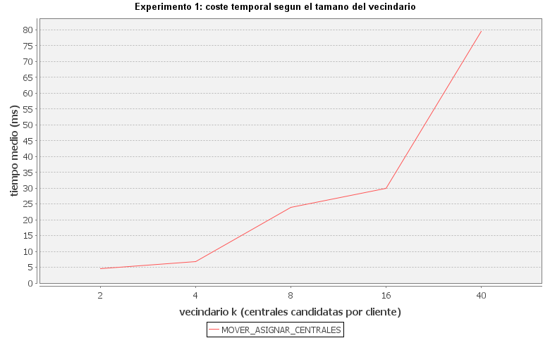{width=88%}

### Estrategia de solución inicial

Expectativa: La inicialización voraz debería partir de más centrales reutilizadas y acabar con mejor beneficio que una semilla aleatoria, aunque deje menos margen de mejora local.

Resultado: `VORAZ` supera a `ALEATORIA` en las 10 réplicas (~1.358.883 € frente a ~1.282.558 €; ~76.325 € de diferencia media, $p = 0{,}002$). La aleatoria permite más pasos de mejora, pero no compensa el peor punto de partida.

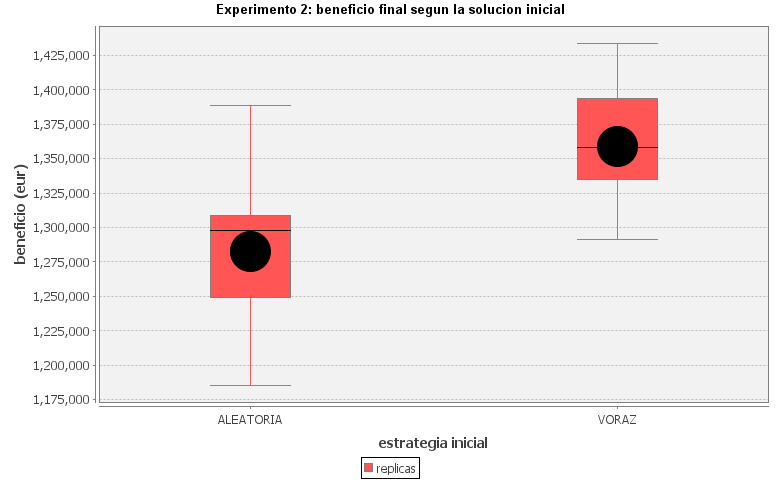{width=88%}

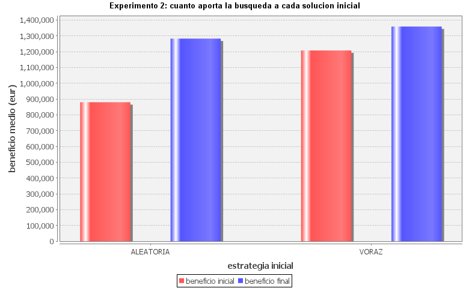{width=88%}

### Parámetros de Simulated Annealing

Expectativa: Temperaturas más altas o más iteraciones exploran más pero encarecen la ejecución; conviene fijar parámetros razonables antes de comparar con Hill Climbing.

Resultado: En el barrido inicial, $\lambda$ pequeños mantienen temperatura efectiva más tiempo (más cómputo) con diferencias de beneficio modestas. Se fijan 100.000 iteraciones, 1.000 por temperatura, $k = 5$ y $\lambda = 0{,}01$ por equilibrio calidad/tiempo, no solo por un máximo puntual.

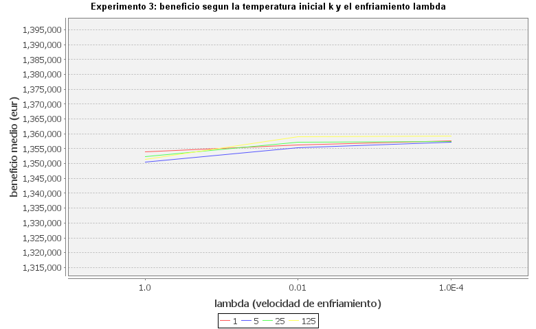{width=88%}

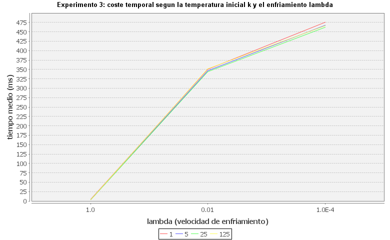{width=88%}

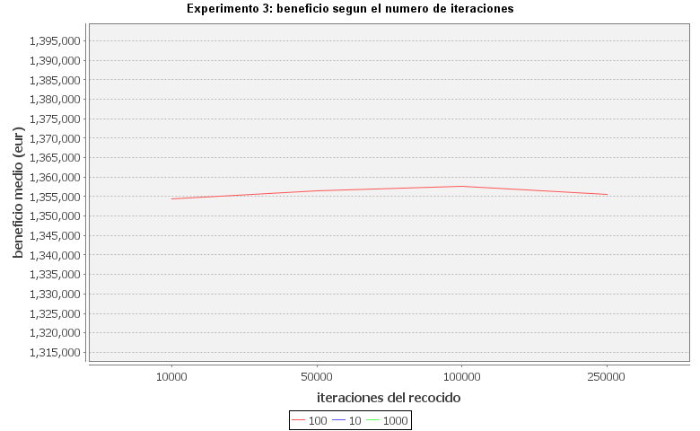{width=88%}

### Escalabilidad con el número de clientes y centrales

Expectativa: El tiempo debería crecer al aumentar clientes o centrales porque hay más movimientos que evaluar.

Resultado: Con centrales fijas, el tiempo crece con el número de clientes; al aumentar centrales, también crecen las alternativas. El coste depende del tamaño de la asignación y del vecindario, no solo del beneficio.

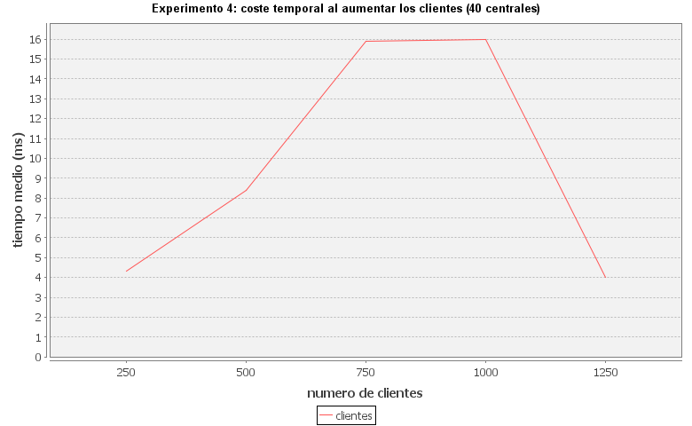{width=88%}

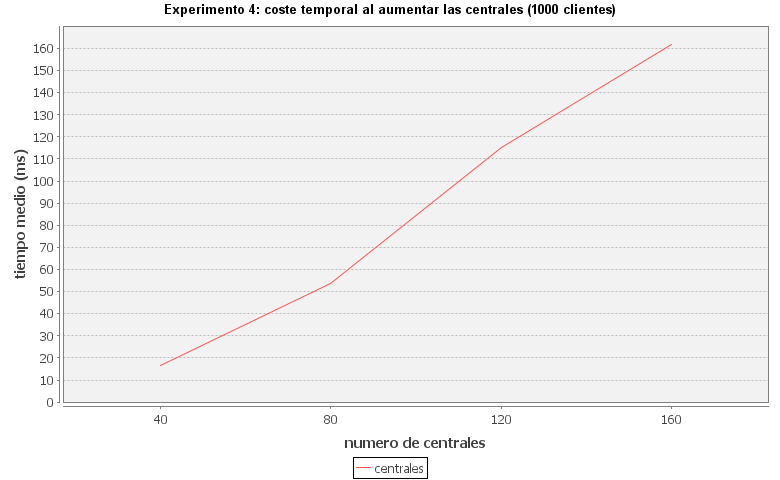{width=88%}

### Penalización de los clientes garantizados no servidos

Expectativa: Penalizar clientes garantizados no servidos permite estudiar la restricción como coste blando; umbrales altos deberían recuperar soluciones válidas.

Resultado: En modo penalización, Hill Climbing con **100 €/MWh** deja **10/10** réplicas válidas; Simulated Annealing necesita alrededor de **500 €/MWh** para el mismo efecto. La validez debe interpretarse aparte del beneficio: más beneficio con garantizados incumplidos no equivale a una solución factible en el modo normal.

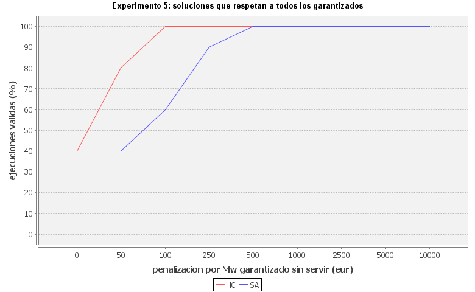{width=88%}

### Ampliación del parque de centrales

Expectativa: Más centrales tipo C no implica necesariamente más beneficio: centrales encendidas sin uso elevan costes.

Resultado: Al pasar de 25 a 50 y 75 centrales de tipo C, el uso medio de **C** sube (~21,5 → ~34,7 en HC), **A** y **B** bajan ligeramente (~5,0 → ~4,5 y ~9,8 → ~9,2), el **beneficio** cae (~1,36 M€ → ~1,15 M€) y Simulated Annealing es **~20–25 veces más lento** que Hill Climbing (en la ejecución regenerada, ~359 ms frente a ~16 ms con 25 centrales C).

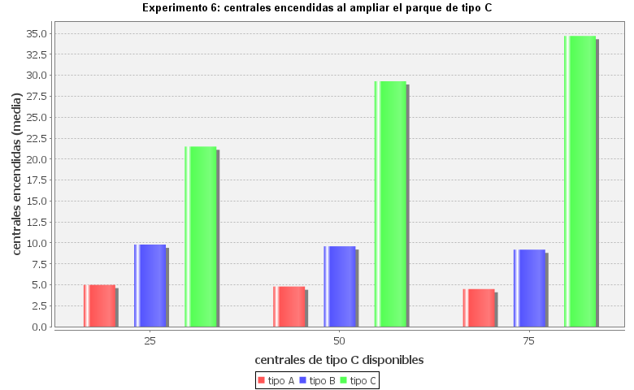{width=88%}

### Comparación de las heurísticas

Expectativa: H2 y H3 deberían desempatar mesetas con operadores simples; con compuestos, H1 bastará.

Resultado: Con `MOVER_ASIGNAR`, H3 ($w = 10$) gana a H1 en 10/10 réplicas ($p = 0{,}002$); H2 vs H1 no es significativo ($p = 0{,}0625$). Con operadores compuestos las diferencias entre heurísticas no son significativas. Las figuras muestran el efecto del peso secundario sobre beneficio real y pasos de Hill Climbing.

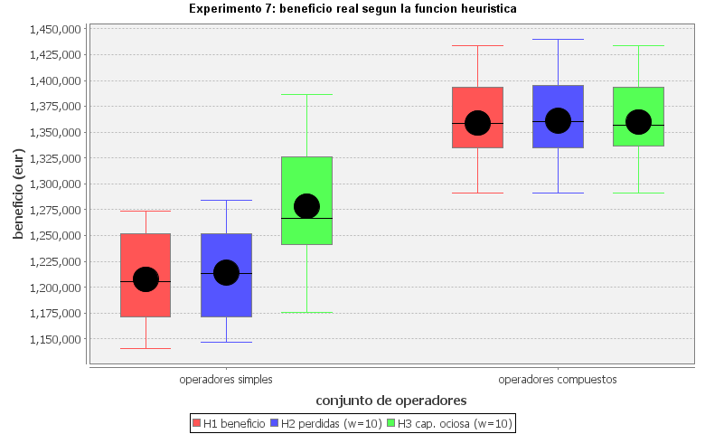{width=88%}

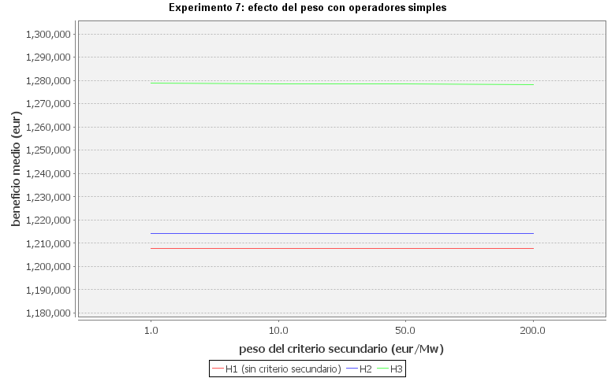{width=88%}

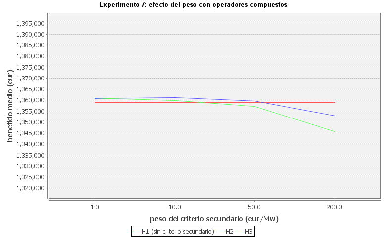{width=88%}

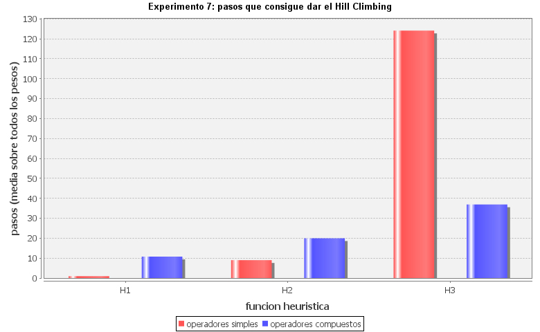{width=88%}

### Hill Climbing y Simulated Annealing

Expectativa: Simulated Annealing debería ayudar con mesetas de operadores simples; con compuestos, Hill Climbing debería ser más rápido con beneficio similar.

Resultado: Con `MOVER_ASIGNAR`, SA gana 10/10 réplicas (~98.486 € de diferencia media, $p = 0{,}002$). Con `MOVER_ASIGNAR_CENTRALES`, SA solo gana 3/10 ($p = 0{,}3438$); ambos alcanzan beneficio similar y HC usa menos tiempo.

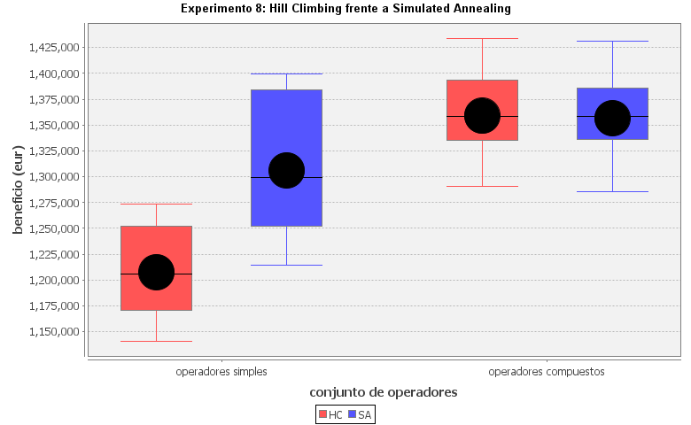{width=88%}

## Ejecución y reproducción

Este apartado describe el procedimiento para repetir compilación, pruebas y experimentos.

### Requisitos y directorio de trabajo

Se necesita JDK 26 o superior y las bibliotecas `CentralEnergia.jar`, `AIMA.jar` y dependencias en `lib/lib/`.

Todas las órdenes se ejecutan desde la raíz del repositorio. Los CSV y figuras van a `results/`; las clases compiladas, a `out/`.

### Compilación

```powershell
javac -cp "lib\CentralEnergia.jar;lib\AIMA.jar;lib\lib\*" `
  -d out (Get-ChildItem -Recurse src -Filter *.java | Where-Object { $_.Name -ne 'Prueba0.java' } | % FullName)
```

El classpath incluye las bibliotecas principales; `lib\lib\*` cubre JFreeChart en ejecución.

### Comprobación de la representación

```powershell
java -cp "out;lib\CentralEnergia.jar;lib\AIMA.jar;lib\lib\*" `
  IA.PracticaEnergia.PruebaEstado
```

### Ejecución de los experimentos

```powershell
java -Xmx2g -cp "out;lib\CentralEnergia.jar;lib\AIMA.jar;lib\lib\*" `
  IA.PracticaEnergia.MainExperimentos todos
```

Un experimento concreto:

```powershell
java -Xmx2g -cp "out;lib\CentralEnergia.jar;lib\AIMA.jar;lib\lib\*" `
  IA.PracticaEnergia.MainExperimentos 1
```

Identificadores del `1` al `8`; alias `heuristicas` y `comparativa`. Para reproducir la batería completa, usar una sola invocación de `todos`. Cada experimento escribe `results/expN.csv`.

### Generación de figuras y comparaciones

```powershell
java -cp "out;lib\CentralEnergia.jar;lib\AIMA.jar;lib\lib\*" `
  IA.PracticaEnergia.Graficas
```

```powershell
java -cp "out;lib\CentralEnergia.jar;lib\AIMA.jar;lib\lib\*" `
  IA.PracticaEnergia.Comparaciones
```

## Análisis y discusión

Los experimentos separan el efecto del vecindario, la inicialización, la heurística y el algoritmo. Hay que leer beneficio junto con tiempo y validez.

### Importancia de los operadores

Abrir y cerrar centrales impacta más que inflar el vecindario sin sentido. Los operadores simples suelen dejar igual el conjunto de centrales encendidas; los compuestos convierten mesetas en mejoras en un paso. `COMPLETO` no mejora el beneficio frente a `MOVER_ASIGNAR_CENTRALES` pero sí el coste.

### Efecto de la solución inicial

`VORAZ` es el factor más estable: mejor beneficio inicial y final que `ALEATORIA`. La búsqueda sigue siendo necesaria; la inicialización condiciona la región alcanzable en presencia de mesetas.

### Papel de las heurísticas

H1 coincide con el objetivo real. H2 y H3 desempatan con operadores simples; H3 mejora significativamente a H1 en ese régimen. Con compuestos, H1 suele bastar porque el vecindario ya expresa encendido/apagado.

### Comparación de los algoritmos

Simulated Annealing ayuda cuando Hill Climbing queda en mesetas con operadores simples. Con compuestos, calidad similar y HC más rápido. La elección depende de si el vecindario expresa las transiciones relevantes.

### Calidad y coste computacional

Hay compromiso entre beneficio y tiempo: más $k$ o iteraciones no siempre pagan. Más centrales no garantiza más beneficio. Evaluar con varias métricas, no una sola media.

## Conclusiones

La práctica modela la distribución de energía como búsqueda local con capacidad, pérdidas y clientes garantizados. `EstadoEnergia` mantiene magnitudes de forma incremental.

1. Los operadores compuestos son determinantes: `MOVER_ASIGNAR_CENTRALES` supera claramente a operadores simples al modificar centrales en una transición.

2. La solución inicial voraz es preferible: `VORAZ` supera a `ALEATORIA` en las réplicas comparadas.

3. Las heurísticas secundarias dependen del vecindario: H2/H3 rompen mesetas con operadores simples; con compuestos, H1 suele ser suficiente.

4. Simulated Annealing ayuda ante mesetas: con operadores simples puede superar a HC; con compuestos, HC alcanza calidad similar con menos tiempo.

5. Capacidad y pérdidas condicionan la factibilidad: más clientes o centrales cambia el espacio de búsqueda sin garantizar mejor beneficio.

En conjunto, para el escenario estudiado: inicialización `VORAZ`, operadores `MOVER_ASIGNAR_CENTRALES` y vecindario moderado ($k = 8$ para Hill Climbing), equilibrando beneficio y cómputo frente al conjunto completo. Conclusión para los parámetros probados, no optimalidad global.


## Trabajo de innovación

### Tema elegido

PathAI y Paige: diagnóstico de cáncer con visión por computador en anatomía patológica digital. El trabajo del cuatrimestre comparará cómo ambas compañías aplican aprendizaje profundo sobre imágenes de láminas histológicas (whole slide imaging) para apoyar al patólogo: detección de regiones sospechosas, visualización y flujo clínico. Nos interesan la validación regulatoria (FDA), el papel del algoritmo como herramienta adjunta (no sustituto del diagnóstico) y los límites éticos (sesgos, generalización entre hospitales). Es un caso concreto de IA en salud con productos ya desplegados y documentación pública.

### Reparto del trabajo

Para el informe de innovación del cuatrimestre repartimos apartados en reunión (8/10/2025): contexto clínico y WSI, producto PathAI, producto Paige, marco ético y comparativa final. Cada apartado lo redactará quien lideró la búsqueda; el borrador conjunto se revisa en Discord antes de entregar.

### Referencias encontradas

Entre el **1 y el 20 de octubre de 2026** recopilamos fuentes regulatorias (FDA), artículos revisados por pares y documentación de producto. En cada punto figura la **fecha de acceso** (consulta en ese intervalo). Las URLs completas son enlaces clicables en el PDF.

- **FDA — Paige Prostate (De Novo DEN200080).** URL: https://www.accessdata.fda.gov/cdrh_docs/pdf20/DEN200080.pdf. Uso en el trabajo: indicaciones y limitaciones como IVD adjunto. Acceso: 01/10/2026.
- **FDA — Resumen decisión DEN200080.** URL: https://www.accessdata.fda.gov/cdrh_docs/reviews/DEN200080.pdf. Uso en el trabajo: validación clínica y deep learning sobre WSI. Acceso: 03/10/2026.
- **FDA — PathAI AISight Dx (510(k) K243391).** URL: https://www.accessdata.fda.gov/cdrh_docs/reviews/K243391.pdf. Uso en el trabajo: PathAI y visualización en patología digital. Acceso: 05/10/2026.
- **FDA — Paige FullFocus (510(k) K241273).** URL: https://www.accessdata.fda.gov/cdrh_docs/reviews/K241273.pdf. Uso en el trabajo: visor de láminas e interoperabilidad PACS. Acceso: 07/10/2026.
- **FDA — Digital pathology (guía para la industria).** URL: https://www.fda.gov/media/133714/download. Uso en el trabajo: marco regulatorio WSI y buenas prácticas. Acceso: 09/10/2026.
- **Campanella et al., *Nature Medicine* 25, 1301–1309 (2019).** URL: https://doi.org/10.1038/s41591-019-0438-z. Uso en el trabajo: IA en cáncer de mama en cohorte real. Acceso: 11/10/2026.
- **Echle et al., *Nature Cancer* 2, 128–138 (2021).** URL: https://doi.org/10.1038/s43018-020-00162-w. Uso en el trabajo: despliegue clínico y generalización. Acceso: 13/10/2026.
- **Lu et al., *Nature Biomedical Engineering* (2021).** URL: https://doi.org/10.1038/s41551-021-00789-6. Uso en el trabajo: deep learning en patología y diseño de estudios. Acceso: 15/10/2026.
- **Topol, *Nature Medicine* 25, 44–56 (2019).** URL: https://doi.org/10.1038/s41591-018-0300-7. Uso en el trabajo: panorama de la IA en medicina (contexto). Acceso: 16/10/2026.
- **PathAI — productos y publicaciones.** URL: https://www.pathai.com/. Uso en el trabajo: línea comercial de PathAI y casos de uso. Acceso: 17/10/2026.
- **Paige — Paige Prostate y plataforma.** URL: https://www.paige.ai/. Uso en el trabajo: ecosistema Paige y mensaje clínico. Acceso: 18/10/2026.
- **WHO — Ethics and governance of AI for health (2021).** URL: https://iris.who.int/handle/10665/340773. Uso en el trabajo: ética, equidad y supervisión humana. Acceso: 19/10/2026.
- **NHS England — AI in pathology (informe).** URL: https://www.england.nhs.uk/ourwork/innovation/ai-lab/. Uso en el trabajo: contexto sanitario público y adopción. Acceso: 20/10/2026.

Además de estas referencias, estamos tomando notas sobre: (i) diferencia entre **algoritmo de detección** (p. ej. Paige Prostate) y **visor/plataforma** (FullFocus, AISight Dx); (ii) requisitos de **validación prospectiva** que exige la FDA en De Novo frente a 510(k); (iii) papers que discuten **sesgo de sitio** (coloración H&E, escáner) porque condiciona si un modelo entrenado en un hospital generaliza en otro.

### Dificultades encontradas

La documentación regulatoria (FDA) es precisa pero densa: hay que distinguir qué producto es un algoritmo de detección y cuáles son visores o plataforma, porque no tienen el mismo rol clínico ni las mismas claims.

También cuesta encontrar divulgación que no mezcle marketing con evidencia: priorizamos resúmenes FDA, DOI en revistas médicas y guías como la de la OMS. Muchos preprints usan conjuntos privados, lo que complica comparar sensibilidad o especificidad entre PathAI y Paige con la misma metodología.

El vocabulario clínico (WSI, H&E, De Novo vs 510(k), IVD) exige varias lecturas; lo resolvemos repartiendo apartados y contrastando en reunión el flujo patólogo–algoritmo–informe. Por último, algunos PDF de la FDA son largos y no están bien indexados: conviene anotar número de decisión (DEN/510k) para citarlos de forma unívoca en el informe final.
